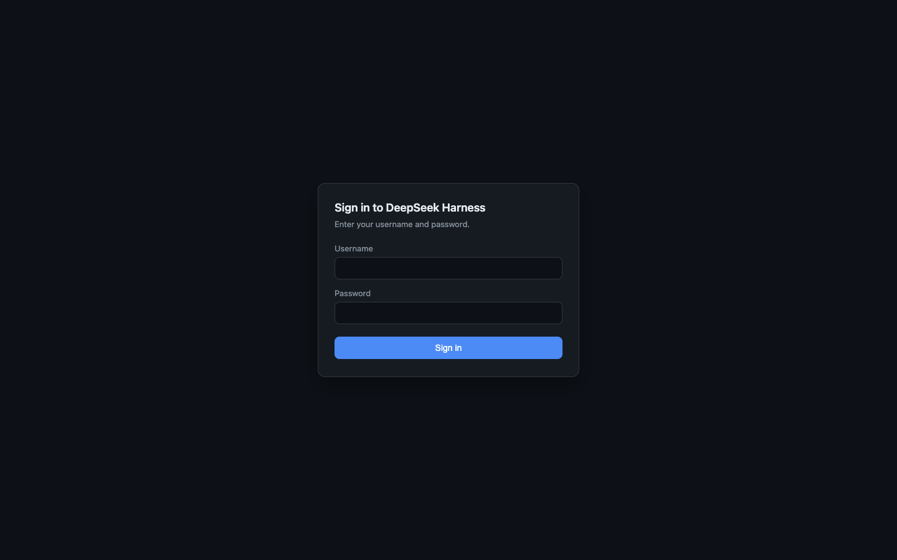
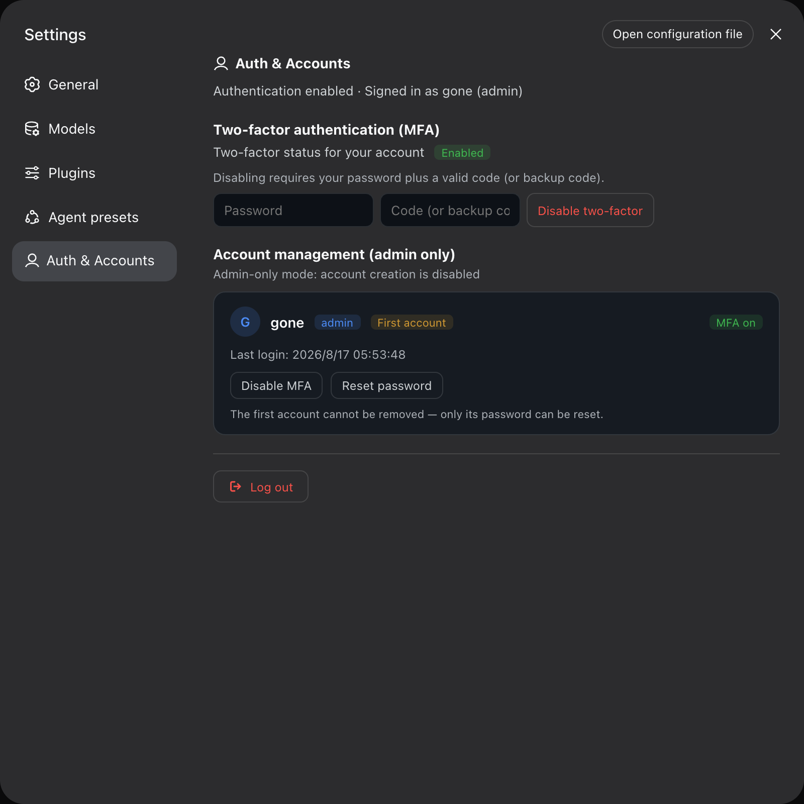

# dsh-remote

<p align="center">
  <a href="https://www.npmjs.com/package/@xgone/dsh-remote"></a>
  <a href="https://www.npmjs.com/package/@xgone/dsh-remote"></a>
  <a href="https://github.com/xgone/dsh-remote/actions/workflows/test.yml"></a>
  <a href="LICENSE"></a>
</p>

<p align="center"><strong>English</strong> · <a href="README.md">中文</a></p>

**Securely expose the DeepSeek Harness Web UI to remote browsers** with a login gate, MFA/TOTP, role-based access, and an in-browser remote file panel. Users sign in from an external browser and get the full DSH experience without native dialogs on the host machine.

> Designed for environments where `dsh web` already works locally. The plugin keeps the service on loopback by default; public access still requires an HTTPS reverse proxy or a secure tunnel.

## Contents

- [Features](#features)
- [Screenshots](#screenshots)
- [Getting started](#getting-started)
- [Remote access](#remote-access)
- [Install as an app](#install-as-an-app-pwa)
- [Configuration](#configuration)
- [Headless servers](#headless-servers-no-local-browser)
- [FAQ](#faq)
- [Documentation](#documentation)
- [Development and tests](#development-and-tests)
- [Uninstall](#uninstall)
- [Known limitations](#known-limitations)

## Features

- **Login gate**: unauthenticated requests to every path are sent to the login page; `/api` and WebSocket traffic require a valid session. Passwords are scrypt-hashed, failed logins are rate limited, and the first admin is loopback-only.
- **MFA / TOTP**: works with Google Authenticator, 1Password, Authy, and other standard authenticators; supports QR binding and 10 one-time backup codes. An admin can disable MFA for an account.
- **Sessions and roles**: signed session cookies; admin-only mode by default, with optional `admin` / `user` / `guest` roles.
- **Remote file panel**: preview code, Markdown, images, PDF, video, audio, text, directories, and extracted `.docx` text in a right-side panel. Unsupported files download directly. Only the DSH home and working directories are readable by default; admins can add allowed roots.
- **Remote access**: works behind nginx, SSH tunnels, Tailscale, Frp, Cloudflare Tunnel, and similar transports with end-to-end WebSocket events.
- **Installable as a desktop or phone app**: the manifest, Service Worker, and icons are served before sign-in, so DSH installs into its own window on desktop and mobile, with the cookie repaired on a cold launch. See [Install as an app](#install-as-an-app-pwa).
- **Browser-native workspace flow**: selecting or creating a workspace uses an in-browser directory dialog instead of opening a host OS file picker.
- **Localized and lightweight**: follows DSH light / dark theme and language, with English and Chinese UI; remote responses are gzipped by default and hashed assets work well with edge caches.

## Screenshots

| Login gate (unauthenticated access) | Settings → Auth & Accounts |
|:---:|:---:|
|  |  |

## Getting started

### 1. Install

```sh
dsh plugin --profile web add @xgone/dsh-remote
```

### 2. Restart `dsh web`

Patches cannot hot-reload, so restart after installing or upgrading:

```sh
dsh web
```

### 3. Create the first admin

Open `http://127.0.0.1:3080` in a local browser. The first visit enters bootstrap mode: enter a username and password (at least 6 characters) to create the first admin, then you are signed in automatically.

> Server without a local browser? See [headless servers](#headless-servers-no-local-browser).

### 4. Bind MFA (recommended)

Go to **Settings → Auth & Accounts → Two-factor authentication (MFA) → Enable**, scan the QR code with your authenticator, and enter the 6-digit code. Save the 10 backup codes first.

### 5. Enable remote access

Verify local login and MFA first, then configure a reverse proxy or tunnel as described in [Remote access](#remote-access). External access must forward WebSockets; HTTPS deployments must also set `session.secure: true`.

## Remote access

`dsh web` listens on the loopback address by default. Expose it through a reverse proxy or tunnel, and do not publish an unencrypted service port directly to the Internet.

The following nginx example preserves the WebSocket upgrade headers:

```nginx
server {
  listen 8443 ssl;
  server_name dsh.example.com;
  ssl_certificate     /etc/letsencrypt/live/dsh.example.com/fullchain.pem;
  ssl_certificate_key /etc/letsencrypt/live/dsh.example.com/privkey.pem;

  location / {
    proxy_pass http://127.0.0.1:3080;
    proxy_http_version 1.1;
    proxy_set_header Upgrade $http_upgrade;
    proxy_set_header Connection "upgrade";
    proxy_set_header Host $host;
    proxy_set_header Origin $http_origin;
  }
}
```

SSH reverse tunnels, Tailscale, Frp, and Cloudflare Tunnel work the same way. For HTTPS deployments, set `session.secure` to `true` in the configuration.

## Install as an app (PWA)

Since 0.3.6, DSH installs as an app in its own window — from the launcher, dock, or taskbar on desktop, from a home-screen icon on mobile — much like a native app.

**Prerequisite: serve it over HTTPS.** A Service Worker only registers in a secure context, so a plain `http://` LAN address (an unencrypted domain, a bare IP) will not install; `localhost` / `127.0.0.1` is the one exception. The same applies to desktop and mobile alike.

Steps: open the deployed HTTPS URL in a browser and sign in once, then pick the entry point for your environment.

| Environment | Where to install |
|---|---|
| Desktop Chromium (Chrome, Edge, Brave, …) | The install icon at the right end of the address bar; or menu → "Install…" / "Apps" → "Install this site". |
| Desktop Safari (macOS Sonoma / Safari 17 and later) | Menu bar **File → Add to Dock**. |
| Android (Chrome, Edge, …) | Menu → "Install app" or "Add to Home screen". |
| iOS Safari (iOS 16.4 and later) | Share → "Add to Home Screen". On iOS, Chrome, Edge, and other third-party browsers route through that same share sheet. |

Firefox does not support manifest-based PWA installation, on desktop or mobile; with Firefox, just use DSH in a regular tab.

> A separate route, unrelated to this section: Chrome / Edge on desktop and Safari on desktop can install **any site** as a standalone window without reading its manifest. That is not the same as the manifest-plus-Service-Worker PWA install above — don't conflate the two when troubleshooting.

Once installed, launching from the app icon runs it in its own window. The plugin already serves the manifest, Service Worker, and icons before sign-in, with the right MIME types, worker scope, and `no-store`; the `dsh-auth` cookie is re-minted only on **authenticated** page responses and injected into that same request, so a cold launch does not stop at the login page.

**No nginx snippet is needed.** All of the above is handled by the plugin itself, so keep the reverse-proxy config above as-is; just confirm the HTTPS certificate and `session.secure`.

## Configuration

Edit the `config` of the `remote` row in `~/.dsh/profiles/web/cordis.patch.yml`:

```yaml
- id: remote
  config:
    enabled: true          # false = disable the gate (escape hatch if locked out)
    session:
      secure: false        # set true for HTTPS deployments
    adminOnly: true        # false = enable admin/user/guest roles
    bootstrap:             # optional: only while the account store is empty
      username: admin
      password: 'replace-with-a-strong-password'
```

| Option | Default | Purpose |
|---|---:|---|
| `enabled` | `true` | Enable or disable the login gate; restart `dsh web` after changing it. |
| `session.secure` | `false` | Set `true` for HTTPS so session cookies are sent only over secure connections. |
| `adminOnly` | `true` | Keep the deployment admin-only; set `false` to enable multi-account roles. |
| `bootstrap` | unset | Provision the first admin on a headless server; remove the plaintext password after the first login. |

See [docs/REFERENCE.md](docs/REFERENCE.md#13-full-configuration-reference) for sessions, MFA, rate limiting, gzip, the file panel, allowed roots, and all other options.

### Headless servers (no local browser)

Add the `bootstrap` block above to `cordis.patch.yml` and restart. The first admin is provisioned at startup, equivalent to local bootstrap. Remove the plaintext password after the first login and bind MFA.

## FAQ

| Symptom | Fix |
|---|---|
| No login page after install | Restart `dsh web`; confirm `@xgone/dsh-remote` is in the bundles list. |
| 403 when creating the admin | The first admin is loopback-only: use a local browser or reach `127.0.0.1` through `ssh -L`; on a headless server use `bootstrap`. |
| Locked out | Set `enabled: false` in `cordis.patch.yml` and restart; or delete `$DSH_HOME/auth/store.json` to re-enter bootstrap mode. |
| Lost MFA / phone | As admin, go to **Settings → Auth & Accounts → that account** and disable MFA. |
| File panel reports `outside-roots` | Go to **Settings → Auth & Accounts → Allowed directories** and add the directory. The change applies immediately. |
| After a dsh upgrade every `/api` call returns 401 despite a successful login | Upgrade this plugin (≥ 0.3.1) and **sign in once more**; see [CHANGELOG](CHANGELOG.md). |
| After a dsh upgrade clicking a file path does nothing / never opens the sidebar | Upgrade this plugin (≥ 0.3.2) and restart `dsh web`; see [CHANGELOG](CHANGELOG.md). |
| Settings pages misbehave / popups return after a dsh upgrade | Upgrade this plugin first; compatibility fixes for new DSH versions ship built-in. See [CHANGELOG](CHANGELOG.md). |
| The browser offers no install entry / the installed app opens as a browser tab | Upgrade this plugin (≥ 0.3.6) and visit it **over HTTPS** (a Service Worker only registers in a secure context, so a bare `http://` IP will not install); Firefox does not support manifest-based installs. See [Install as an app](#install-as-an-app-pwa). |
| A cold launch from the app icon still stops at the login page | Plugin ≥ 0.3.6 re-mints the `dsh-auth` cookie automatically. If it still happens, check that the proxy is not rewriting `Host`. |

## Documentation

- **Changelog**: [CHANGELOG.md](CHANGELOG.md) — version changes and upgrade compatibility fixes.
- **Technical reference**: [docs/REFERENCE.md](docs/REFERENCE.md) — architecture, implementation details, full configuration, and endpoint reference.
- **Cloudflare Tunnel deployment**: [docs/CLOUDFLARE-TUNNEL.en.md](docs/CLOUDFLARE-TUNNEL.en.md) — tunnel access without a public IP or open inbound ports.
- **npm package**: [@xgone/dsh-remote](https://www.npmjs.com/package/@xgone/dsh-remote).

## Development and tests

```sh
pnpm install
pnpm check
pnpm test
```

`pnpm test` runs Node syntax checks and the complete test suite. GitHub Actions runs the same tests on Node.js 20, 22, and 24.

## Uninstall

```sh
dsh plugin --profile web remove @xgone/dsh-remote
```

Restart `dsh web` to remove the gate. Account data remains in `$DSH_HOME/auth/store.json`; delete that file separately for a complete reset.

## Known limitations

- Configuration changes require restarting `dsh web`; HMR is disabled on the web surface.
- All accounts share the same workspaces and session data. DSH core is single-tenant, so the plugin cannot isolate data; run one profile instance per person when isolation matters, for example `dsh --profile alice --port 3081`.

## License

[MIT](LICENSE)
